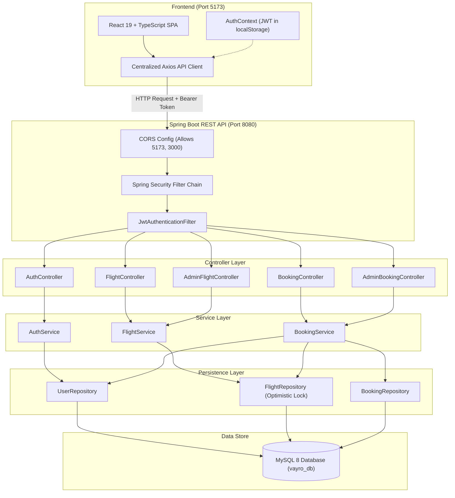

# Vayro — Airline Reservation System

> **Tagline:** *Your Journey, Simplified.*

[](https://www.oracle.com/java/)
[](https://spring.io/projects/spring-boot)
[](https://spring.io/projects/spring-security)
[](https://react.dev/)
[](https://www.typescriptlang.org/)
[](https://vitejs.dev/)
[](https://tailwindcss.com/)
[](https://www.mysql.com/)
[](http://localhost:8080/swagger-ui/index.html)
[](LICENSE)

---

## 1. Project Overview

**Vayro** is an enterprise-grade full-stack airline reservation platform engineered to deliver a seamless, dependable, and high-performance booking experience for travelers and airline flight operations managers.

The system pairs a **Spring Boot 3** REST API backend with a responsive, modern **React 19 + TypeScript + Vite** frontend. Vayro handles flight scheduling, route-based search, atomic concurrency-safe seat allocation, customer reservation lifecycles, and role-based administrative operations with strict data integrity and security controls.

### Problems Solved
- **Inventory Overselling:** Prevents race conditions during simultaneous seat reservations via optimistic concurrency locking (`@Version`) on flight entities.
- **Tamper-Proof Financial Calculation:** Ensures total pricing is strictly computed on the server using high-precision currency arithmetic (`BigDecimal`), immune to client-side payload manipulation.
- **Granular Security & Role Separation:** Enforces stateless JWT authentication and strict Role-Based Access Control (`ROLE_USER` vs. `ROLE_ADMIN`), ensuring customers only inspect their own reservations while isolating flight scheduling to verified administrators.
- **Reservation Lifecycle Integrity:** Enforces idempotent booking state transitions (`CONFIRMED` and `CANCELLED`), guaranteeing that cancelled bookings immediately restore seat inventory without double-release anomalies.

---

## 2. Key Features

### Traveler Experience (Public & Customer)
- **Flight Discovery & Search:**
  - Search scheduled flights by origin city/airport code, destination, travel date, and minimum passenger count.
  - Case-insensitive airport code and city matching.
  - Sorting by departure time (earliest/latest), price (lowest/highest), and available seats.
  - Paginated schedule browsing for all active flights.
- **Flight Reservation Workflow:**
  - Flight itinerary summary with departure, arrival, and duration calculations.
  - Dynamic passenger information capture (1 to 10 travelers per reservation).
  - Clear notification that payment gateway processing is simulated in demonstration mode.
  - Instant seat reservation with guaranteed database-level lock.
- **Digital Boarding Pass & Confirmation:**
  - Cryptographically unique booking reference (`VAYRO-XXXXXXXX`).
  - Printable boarding pass view displaying passenger count, route, timestamps, and fare details.
- **Traveler Dashboard (My Bookings):**
  - Full personal reservation history with booking status badges (`CONFIRMED` or `CANCELLED`).
  - Direct booking cancellation workflow with seat restoration warning dialog.

### Administration & Operations (`ROLE_ADMIN`)
- **Mission Control Dashboard:**
  - Tabbed administrative console with live stats and quick refresh.
  - **Flight Scheduling:** Modal form to create new flight schedules with route, capacity, timing, and ticket price.
  - **Schedule Modification:** Update departure/arrival times, capacity, and prices of existing flights.
  - **Operational Dispatch:** Update real-time flight operational statuses (`SCHEDULED`, `ACTIVE`, `DELAYED`, `CANCELLED`, `COMPLETED`).
- **Platform Reservations Audit:**
  - Complete platform-wide booking ledger displaying customer names, emails, flight numbers, passenger counts, and total revenue.

### Authentication & Infrastructure
- **Stateless Authentication:** Secure JWT issuance and signature validation using HMAC-SHA256 (`io.jsonwebtoken` 0.12.6).
- **Password Security:** Salted BCrypt password hashing (`BCryptPasswordEncoder`).
- **Uniform Error Handling:** Centralized `@RestControllerAdvice` formatting business and validation errors into consistent JSON responses.
- **Interactive Documentation:** Live Swagger UI OpenAPI 3.0 specification available at `/swagger-ui/index.html`.

---

## 3. Technology Stack

### Frontend
| Component | Technology | Version |
| :--- | :--- | :--- |
| **Framework** | React | 19.3.1 |
| **Language** | TypeScript | 6.0.2 |
| **Build Tool & Server** | Vite | 8.3.0 |
| **Styling** | Tailwind CSS | 4.3.3 |
| **Vite Tailwind Plugin** | `@tailwindcss/vite` | 4.3.3 |
| **Routing** | React Router | 7.18.4 |
| **HTTP Client** | Axios | 1.20.0 |
| **Icons** | Lucide React | 1.59.0 |
| **Typography** | Google Fonts (*Outfit*, *Plus Jakarta Sans*) | Modern Web Fonts |

### Backend
| Component | Technology | Version |
| :--- | :--- | :--- |
| **Runtime** | Java Development Kit (JDK) | OpenJDK 17 LTS |
| **Framework** | Spring Boot | 3.3.4 |
| **Security** | Spring Security | 6.x |
| **JWT Library** | JJWT (`jjwt-api`, `jjwt-impl`, `jjwt-jackson`) | 0.12.6 |
| **ORM / Persistence** | Spring Data JPA / Hibernate | 6.5.x |
| **Validation** | Jakarta Bean Validation / Hibernate Validator | 8.x |
| **API Documentation** | Springdoc OpenAPI Starter WebMVC UI | 2.6.0 |
| **Build Tool** | Apache Maven | 3.9+ |

### Database & Concurrency
| Component | Technology | Details |
| :--- | :--- | :--- |
| **Primary Database** | MySQL | 8.0+ (`vayro_db`) |
| **Test In-Memory DB** | H2 Database | 2.x (MySQL compatibility mode) |
| **Locking Strategy** | Optimistic Locking | JPA `@Version` on `Flight` entity |

---

## 4. System Architecture

Vayro follows a decoupled, layered client-server architecture:



---

## 5. Project Directory Structure

```
Airline reservation system/
├── pom.xml                               # Root Maven project build definition
├── package.json                          # Root scripts runner (concurrently)
├── README.md                             # Project technical documentation
├── src/                                  # Spring Boot Backend Source Code
│   ├── main/
│   │   ├── java/com/vayro/airline/
│   │   │   ├── VayroAirlineApplication.java
│   │   │   ├── config/                   # SecurityConfig, OpenApiConfig, DataInitializer
│   │   │   ├── controller/               # REST API Controllers (Auth, Flight, Booking, Admin)
│   │   │   ├── dto/                      # Request & Response Data Transfer Objects
│   │   │   ├── entity/                   # JPA Entities (User, Flight, Booking)
│   │   │   ├── enums/                    # Enums (Role, FlightStatus, BookingStatus)
│   │   │   ├── exception/                # GlobalExceptionHandler & custom exceptions
│   │   │   ├── mapper/                   # Entity-to-DTO conversion mappers
│   │   │   ├── repository/               # Spring Data JPA Repositories
│   │   │   ├── security/                 # JwtTokenProvider, CustomUserDetailsService
│   │   │   └── service/                  # Business logic services & implementations
│   │   └── resources/
│   │       └── application.properties    # Backend configuration & environment overrides
│   └── test/                             # Automated JUnit 5 & Concurrency test suites
│       └── java/com/vayro/airline/
│           ├── BookingConcurrencyTest.java
│           └── VayroIntegrationTest.java
└── frontend/                             # React 19 + TypeScript + Vite Application
    ├── index.html                        # Application HTML entry point
    ├── package.json                      # Frontend dependencies & scripts
    ├── tsconfig.json                     # TypeScript compiler configuration
    ├── vite.config.ts                    # Vite config with React, Tailwind, and proxy
    └── src/
        ├── main.tsx                      # React root rendering entry point
        ├── App.tsx                       # React Router configuration & route mapping
        ├── index.css                     # Tailwind CSS v4 styling & theme tokens
        ├── api/                          # Centralized Axios client & API service modules
        │   ├── client.ts                 # Axios instance with JWT interceptors
        │   ├── auth.ts                   # Login, register, profile calls
        │   ├── flights.ts                # Flight list & search calls
        │   ├── bookings.ts               # Booking create, list, cancel calls
        │   └── admin.ts                  # Administrative flight & booking calls
        ├── components/common/            # Reusable UI components
        │   ├── Navbar.tsx                # Brand header with responsive navigation
        │   ├── Footer.tsx                # Luxury footer with status badges
        │   ├── ProtectedRoute.tsx        # Route guard for authenticated & admin users
        │   └── LoadingSpinner.tsx        # Aviation-themed loading spinner
        ├── context/
        │   └── AuthContext.tsx           # React Context for JWT & user session state
        ├── pages/                        # View pages
        │   ├── HomePage.tsx              # Landing page with hero & search widget
        │   ├── FlightSearchPage.tsx      # Flight schedule browser & search filters
        │   ├── BookingPage.tsx           # Passenger checkout form
        │   ├── BookingConfirmationPage.tsx # Digital e-ticket & boarding pass
        │   ├── MyBookingsPage.tsx        # Customer reservation history & cancellation
        │   ├── LoginPage.tsx             # Sign in with admin demo autofill
        │   ├── RegisterPage.tsx          # Customer registration form
        │   └── AdminDashboardPage.tsx    # Admin flight scheduling & booking audit
        └── types/
            └── index.ts                  # TypeScript interfaces matching backend DTOs
```

---

## 6. Prerequisites

Ensure the following tools are installed on your environment before starting:

- **Java JDK:** OpenJDK 17 or higher
- **Apache Maven:** 3.9+ (or use installed Maven wrapper if available)
- **Node.js:** v18.0.0 or higher
- **npm:** v9.0.0 or higher
- **MySQL Server:** 8.0+ running on port `3306`

Verify installations in your terminal:
```powershell
java -version
mvn -version
node -v
npm -v
```

---

## 7. Database Configuration

The application connects to a MySQL database named **`vayro_db`**. By default, the JDBC URL includes `createDatabaseIfNotExist=true`, allowing MySQL to automatically create the database upon initial backend connection.

### Default Connection Settings
- **Host:** `localhost:3306`
- **Database:** `vayro_db`
- **Username:** `root`
- **Password:** *(empty by default)*

### Initializing the Database Manually (Optional)
If your MySQL instance restricts automated database creation:
```sql
CREATE DATABASE IF NOT EXISTS vayro_db CHARACTER SET utf8mb4 COLLATE utf8mb4_unicode_ci;
```

Hibernate will automatically generate and update all tables (`users`, `flights`, `bookings`) upon startup according to `spring.jpa.hibernate.ddl-auto=update`.

---

## 8. Environment Variables

The backend reads configuration from system environment variables with sensible local defaults in `application.properties`:

| Variable | Description | Default Local Value |
| :--- | :--- | :--- |
| `DB_URL` | JDBC Connection String | `jdbc:mysql://localhost:3306/vayro_db?createDatabaseIfNotExist=true&useSSL=false&serverTimezone=UTC&allowPublicKeyRetrieval=true` |
| `DB_USERNAME` | MySQL Database Username | `root` |
| `DB_PASSWORD` | MySQL Database Password | *(empty)* |
| `SERVER_PORT` | Spring Boot HTTP Port | `8080` |
| `JWT_SECRET` | HMAC-SHA256 Signing Key (>= 256 bits) | `VayroEnterpriseSecureSigningKeyMustBe256BitsLongForHmacSha256Security123456` |
| `JWT_EXPIRATION_MS` | JWT Validity Window in ms (24h) | `86400000` |
| `ADMIN_EMAIL` | Default Administrator Email | `admin@vayro.com` |
| `ADMIN_PASSWORD` | Default Administrator Password | `Admin@Vayro2026!` |

### Setting Environment Variables in Windows PowerShell
```powershell
$env:DB_USERNAME="root"
$env:DB_PASSWORD="YourSecurePassword"
$env:JWT_SECRET="YourCustomSecure256BitOrHigherSecretKeyStringForProduction1234"
```

---

## 9. Installation and Setup

### Step 1: Clone the Repository
```powershell
git clone <repository-url>
cd "Airline reservation system"
```

### Step 2: Install Root & Frontend Dependencies
From the root project directory:
```powershell
# Install root orchestration tools (concurrently)
npm install

# Install frontend React dependencies
cd frontend
npm install
cd ..
```

---

## 10. Running the Application

You can start both services concurrently from the root directory or run them in separate terminals.

### Option A: Run Both Services Concurrently (Recommended)
From the root project directory:
```powershell
npm run dev
```
*This starts the Spring Boot backend (`npm run backend`) and the Vite React frontend (`npm run frontend`) side-by-side using `concurrently`.*

### Option B: Run in Separate Terminals

#### Terminal 1 — Backend (Spring Boot):
```powershell
cd "c:\Projects\Airline reservation system"
mvn spring-boot:run
```
*The backend starts at: `http://localhost:8080`*

#### Terminal 2 — Frontend (Vite + React):
```powershell
cd "c:\Projects\Airline reservation system\frontend"
npm run dev
```
*The frontend starts at: `http://localhost:5173`*

---

## 11. Initial Seeding & Demo Credentials

When the backend starts up with an empty database, [DataInitializer.java](file:///c:/Projects/Airline%20reservation%20system/src/main/java/com/vayro/airline/config/DataInitializer.java) automatically initializes:

1. **Default Administrator Account:**
   - **Email:** `admin@vayro.com`
   - **Password:** `Admin@Vayro2026!`
   - **Role:** `ROLE_ADMIN`
   *(A quick-fill button for this account is available on the frontend `/login` page).*

2. **3 Sample Demonstrative Flights:**
   - `VY-101`: New York (`JFK`) → London (`LHR`)
   - `VY-202`: San Francisco (`SFO`) → Tokyo (`HND`)
   - `VY-303`: Dubai (`DXB`) → Singapore (`SIN`)

---

## 12. REST API Documentation

All endpoints are prefixed with `/api/v1`. Live interactive Swagger UI is accessible at:
👉 **[http://localhost:8080/swagger-ui/index.html](http://localhost:8080/swagger-ui/index.html)**

### Authentication Endpoints (`/api/v1/auth`)
| Method | Endpoint | Auth | Description |
| :--- | :--- | :--- | :--- |
| `POST` | `/api/v1/auth/register` | Public | Register customer account strictly with `ROLE_USER`. |
| `POST` | `/api/v1/auth/login` | Public | Authenticate email and password; returns JWT token. |
| `GET` | `/api/v1/auth/me` | Bearer Token | Retrieve profile information of the authenticated user. |

### Flight Browsing & Search (`/api/v1/flights`)
| Method | Endpoint | Auth | Description |
| :--- | :--- | :--- | :--- |
| `GET` | `/api/v1/flights` | Public | List all scheduled flights with pagination and sorting. |
| `GET` | `/api/v1/flights/{id}` | Public | Retrieve full flight details by flight ID. |
| `GET` | `/api/v1/flights/search` | Public | Query flights by `source`, `destination`, `travelDate`, and `minSeats`. |

### Booking Operations (`/api/v1/bookings`)
| Method | Endpoint | Auth | Description |
| :--- | :--- | :--- | :--- |
| `POST` | `/api/v1/bookings` | Bearer Token | Reserve seats on a flight (`flightId`, `numberOfPassengers`). |
| `GET` | `/api/v1/bookings/my` | Bearer Token | Retrieve current user's booking history (paginated). |
| `GET` | `/api/v1/bookings/{reference}` | Bearer Token | Fetch details of a reservation using its reference code. |
| `PATCH` | `/api/v1/bookings/{reference}/cancel` | Bearer Token | Cancel reservation and immediately release reserved seats. |

### Administrative Operations (`/api/v1/admin`)
| Method | Endpoint | Auth | Description |
| :--- | :--- | :--- | :--- |
| `POST` | `/api/v1/admin/flights` | `ROLE_ADMIN` | Schedule a new flight. |
| `PUT` | `/api/v1/admin/flights/{id}` | `ROLE_ADMIN` | Update flight route, schedule, capacity, or price. |
| `PATCH` | `/api/v1/admin/flights/{id}/status` | `ROLE_ADMIN` | Update flight status (`SCHEDULED`, `ACTIVE`, `DELAYED`, `CANCELLED`, `COMPLETED`). |
| `GET` | `/api/v1/admin/bookings` | `ROLE_ADMIN` | Audit all bookings platform-wide across all users. |

---

## 13. Authentication & Authorization Flow

```
1. Customer registers via POST /api/v1/auth/register or logs in via POST /api/v1/auth/login.
2. Server validates credentials with BCrypt and returns an AuthResponse containing:
   - token: Signed JWT string
   - tokenType: "Bearer"
   - expiresIn: 86400000 ms
   - user: Summary profile with role (ROLE_USER or ROLE_ADMIN)
3. Frontend stores the token in localStorage ('vayro_token').
4. The centralized Axios client attaches the header:
   Authorization: Bearer <token>
5. JwtAuthenticationFilter validates signature and expiration, loading UserPrincipal into SecurityContext.
6. Method security (@PreAuthorize("hasRole('ADMIN')")) guards administrative actions.
```

---

## 14. Testing

### Automated Backend Test Suite
The backend contains unit tests, integration tests, and concurrency race-condition tests utilizing an isolated in-memory H2 database:

```powershell
# Run all backend automated tests
mvn clean test
```

#### Key Tests Included:
- **`BookingConcurrencyTest`**: Simulates concurrent worker threads attempting to book the last available seats on a single flight to verify that optimistic locking prevents inventory overselling.
- **`VayroIntegrationTest`**: Executes full registration, authentication, flight scheduling, search, booking creation, and cancellation workflows using `MockMvc`.

### Frontend Typecheck & Production Build
```powershell
cd frontend
npm run build
```
*Validates that TypeScript compiles cleanly without errors and outputs optimized production assets in `frontend/dist/`.*

---

## 15. Screenshots

> Placeholders for application visuals. Replace with actual screenshots upon production asset generation.

| Screen | Description |
| :--- | :--- |
|  | **Home Page:** Hero banner, flight search widget, and featured routes. |
|  | **Flight Search Page:** Active flight schedules, duration, and direct booking actions. |
|  | **Booking Confirmation:** Official digital boarding pass with reference code and print option. |
|  | **Admin Console:** Flight schedule creation modal and platform bookings audit. |

---

## 16. Troubleshooting

### 1. MySQL Access Denied / Connection Refused
- **Symptom:** `CommunicationsException: Communications link failure` or `Access denied for user 'root'@'localhost'`.
- **Resolution:** Verify MySQL service is running. If your root account has a password, provide it via environment variable:
  ```powershell
  $env:DB_PASSWORD="your_password"
  mvn spring-boot:run
  ```

### 2. Port 8080 Already in Use
- **Symptom:** `Web server failed to start. Port 8080 was already in use.`
- **Resolution:** Identify and terminate the blocking process, or override the port:
  ```powershell
  # Find PID using port 8080
  netstat -ano | findstr :8080
  # Stop process or start on alternative port
  $env:SERVER_PORT="8081"
  mvn spring-boot:run
  ```

### 3. Port 5173 Already in Use
- **Symptom:** Vite starts on `http://localhost:5174` instead of `5173`.
- **Resolution:** Stop other running Vite instances, or update the CORS configuration in `SecurityConfig.java` to allow the new port.

### 4. CORS Errors in Browser Console
- **Symptom:** `Access to XMLHttpRequest at 'http://localhost:8080' from origin 'http://localhost:5173' has been blocked by CORS policy`.
- **Resolution:** Ensure `SecurityConfig.java` contains `http://localhost:5173` in `setAllowedOrigins`. The project is preconfigured to permit Vite's default dev origin.

### 5. JWT Expiration or Unauthorized 401
- **Symptom:** API requests fail with status 401 Unauthorized.
- **Resolution:** Sign out and log back in to refresh your JWT token, or clear your browser's local storage:
  ```javascript
  localStorage.removeItem('vayro_token');
  ```

---

## 17. Planned Future Enhancements

The following features represent planned architecture roadmap items:
- **Payment Gateway Integration:** Direct integration with Stripe or PayPal for processing live card transactions.
- **Interactive Seat Map:** Interactive graphical airplane cabin layout (e.g., choosing Window 12A vs. Aisle 12B).
- **Automated Notifications:** Asynchronous email dispatch via SendGrid or AWS SES delivering booking confirmation PDFs.
- **Baggage & Ancillary Add-Ons:** Configurable checked luggage, priority boarding, and in-flight meal options.
- **Multi-City & Return Routing:** Support for roundtrip and complex multi-leg itinerary search algorithms.

---

## 18. Learning Outcomes & Architectural Concepts

Building and reviewing Vayro demonstrates competency in:
- **Distributed Concurrency Control:** Mitigating race conditions using JPA optimistic locking (`@Version`) rather than error-prone manual application locks.
- **Stateless REST Security:** Implementing token-based authentication with Spring Security filter chains and custom entry points.
- **Precision Financial Mathematics:** Using `BigDecimal` across entities and DTOs to avoid IEEE-754 floating point rounding errors in ticket fares.
- **Modern Full-Stack Integration:** Consuming paginated, validated REST APIs with React 19, TypeScript interfaces, and Axios interceptors.
- **Design System Implementation:** Crafting custom luxury UI with Tailwind CSS v4, Google Fonts, and micro-interactions.

---

## 19. Author & License

- **Project:** Vayro — Airline Reservation System
- **Tagline:** *Your Journey, Simplified.*
- **License:** Distributed under the [ISC License](LICENSE).
